# NACA 2412 CFD Validation and Stall Modelling

## 1. Overview

### Background

This project aims to develop a  reliable aerodynamic dataset for a 2D flight simulation project, by
combining Computational Fluid Dynamics(CFD),XFOIL and empirical aerodynamic models.

ANSYS Fluent is used to investigate the aerodynamic behavior of a NACA 2412 airfoil, with particular attention to the accuracy of predictions and the modelling of flow separation and stall.

### Objectives

1. Low Angle-of-Attack Validation

Compare Fluent predictions with XFOIL results at low angles of attack. Lift, drag, pitching moment, pressure coefficient and skin-friction distributions are examined to assess the agreement between the two methods.

2. Numerical Setup and Stall Investigation

The validated numerical setup will then be extended towards higher angles of attack to study flow separation and stall onset.

3. Post-Stall Aerodynamic Modelling

Explore the use of the Viterna–Corrigan empirical model to extend aerodynamic coefficient predictions into the post-stall region, using suitable aerodynamic data from the preceding analyses.

The current work focuses on low-angle-of-attack validation at approximately $Re=10^6$, using the NACA 2412 airfoil and the Transition SST model in ANSYS Fluent.

Mesh and computational-domain sensitivity investigations are ongoing. High-angle-of-attack simulations and post-stall modelling are planned for later stages.

## 2. Simulation Setup

### 2.1 Geometey and Flow Conditions

A NACA 2412 airfoil was selected for this study. The airfoil geometry was imported to ANSYS Fluent Meshing and scaled to a chord length of 1.016m.

The initial validation case was conducted at an angle of attack of 4°, with a Reynolds number of approximately $10^6$.

Here is the parameters:

| Parameter | Value |
| --- | --- | 
| Reynolds number | $Re = 10^6$ |
| Air Speed | $14.37 m s^-1$ |
| Angle of Attack |  $4^\circ$ |
| Depth | $1m$ |
| Area | $1.016 m^2$ |

### 2.2 Solver and Physical Models

ANSYS Fluent was used to simulate the flow around the NACA 2412. The mesh was generated using ANSYS Fluent Meshing.

The Transition SST model was selected to account for laminar-to-turbulent transition, which can significantly influence boundary-layer behaviour, flow separation, and aerodynamic drag.

| Parameter | Value |
| --- | --- | 
| CFD Solver | ANSYS Fluent |
| Simulation Type | Steady-state |
| Flow Dimension |  2D |
| Turbulence Model | Transition SST |
| Inlet Turbulent intensity | $0.1%$ |
| Meshing Tool | ANSYS Fluent Meshing |

### 2.3 Boundary Condition

The computational domain was configured with velocity inlets on the left and bottom boundaries, and pressure outlets on the right and top boundaries.

The airfoil surface was defined as a stationary no-slip wall.

| Boundary | Type | Specification |
|---|---|---|
| Left | Velocity Inlet | Freestream velocity |
| Bottom | Velocity Inlet | Freestream velocity |
| Right | Pressure Outlet | Gauge pressure = 0 Pa |
| Top | Pressure Outlet | Gauge pressure = 0 Pa |
| Airfoil Surface | Wall | Stationary, no-slip |

Inlet Velocity Components

To simulate an angle of attack of $\alpha = 4^\circ$, the freestream velocity was resolved into horizontal and vertical components:

$$
U_x = U_\infty \cos(\alpha)
$$

$$
U_y = U_\infty \sin(\alpha)
$$

For $U_\infty = 14.37\ \mathrm{m/s}$:

$$
U_x \approx 14.325\ \mathrm{m/s}
$$

$$
U_y \approx 1.002\ \mathrm{m/s}
$$

### 2.4 XFOIL Reference Setup

XFOIL was used to generate reference aerodynamic data for comparison with ANSYS Fluent.

To ensure a meaningful comparison, the same airfoil geometry, Reynolds number, and angle of attack were used in both simulations.

The XFOIL simulation parameters are summarised below:

| Boundary | Value |
| --- | --- |
| Software | XFOIL 6.99 |
| Airfoil | NACA 2412 |
| Reynolds Number | $Re \approx 10^6$ |
| Angle-of-Attack | $\alpha = 4^\circ$ |
| Mach Numbver | $M = 0.0421$ |

The comparison focuses on the following aerodynamic quantities:

Lift coefficient ($C_L$)

Drag coefficient ($C_D$)

Pitching moment coefficient ($C_M$)

Pressure coefficient distribution ($C_p$)

Skin-friction coefficient distribution ($C_f$)

XFOIL predictions are used as a numerical reference rather than experimental validation data. Agreement between the two solvers provides an initial consistency check, but does not independently establish the physical accuracy of the CFD results.

## 3. Meshing Setup

### 3.1 Mesh Strategy

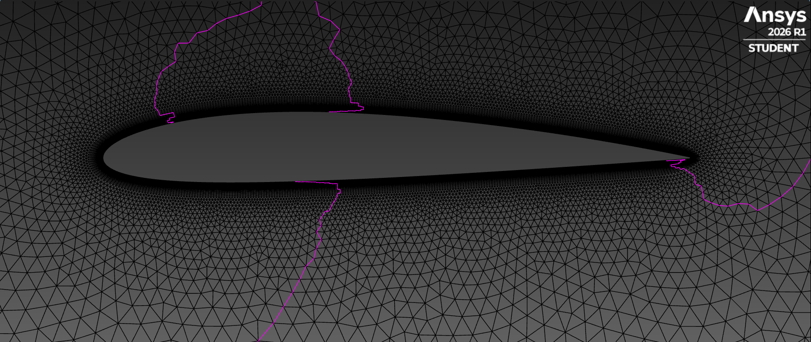

The computational mesh was generated using ANSYS Fluent Meshing for a two-dimensional NACA 2412 airfoil.

The mesh was designed to provide sufficient resolution near the airfoil surface, particularly within the boundary layer, while maintaining a relatively coarse mesh in the far-field region to reduce computational cost.

Local mesh refinement was considered near the leading and trailing edges, where strong pressure gradients and rapid changes in flow behaviour may occur.

Boundary-layer inflation was applied along the airfoil surface to improve near-wall resolution and support the Transition SST model.

The near-wall mesh parameters, including the first-layer height, growth rate, and number of inflation layers, were estimated analytically before mesh generation. The resulting wall resolution was subsequently assessed using the dimensionless wall distance, $y^+$.

### 3.2 Near-Wall Resolution

To resolve the boundary layer near the airfoil surface, a target dimensionless wall distance of $y^+ \approx 1$ was selected for the Transition SST model.

The handwritten derivation is shown below:


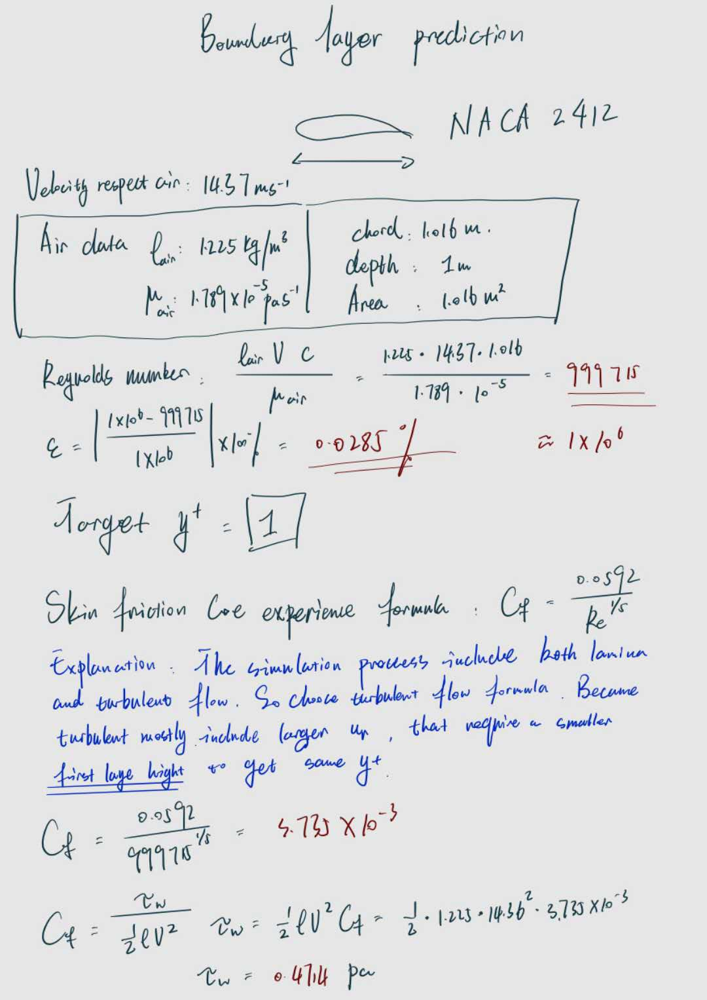
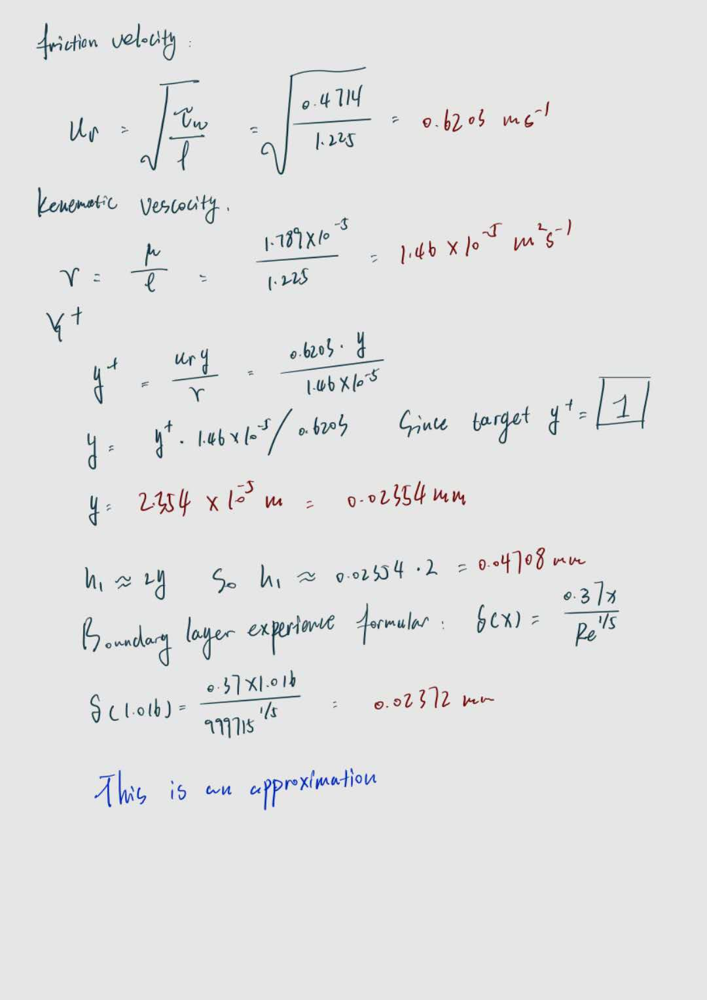
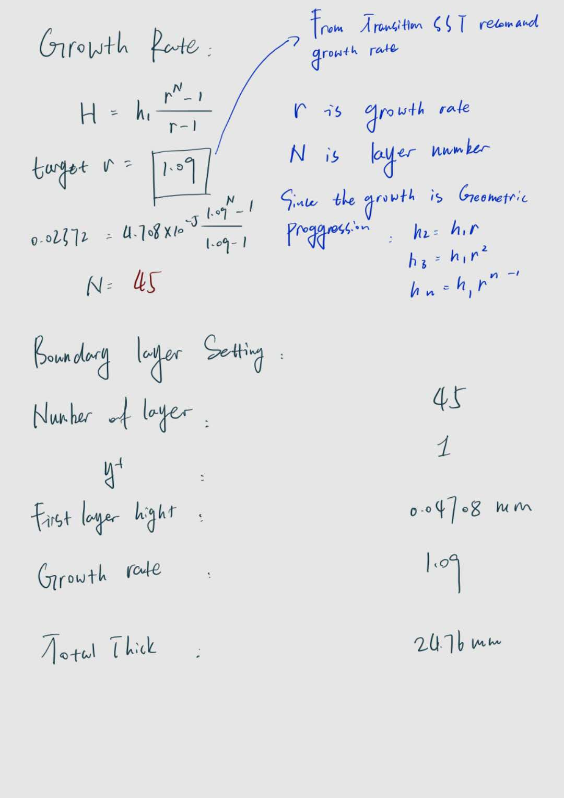

The boundary-layer mesh was designed using a geometric growth distribution to provide a gradual increase in cell height away from the airfoil surface.

The inflation-layer parameters were estimated analytically, as shown in the handwritten calculations above.

| Parameter | Value |
| --- | --- |
| Growth Rate | 1.09 |
| Number of Layers | 45 |
| First Layer Height | $0.04708mm$ |
| Target y+ | 1 |
| Total Thickness | $24.76mm$ |

These values represent the analytical mesh design and should be distinguished from the settings of the final generated mesh.

The actual near-wall resolution is assessed using the $y^+$ distribution obtained from Fluent.

### 3.3 Mesh Sizing Controls

Global and local mesh sizing controls were applied to balance computational cost and spatial resolution.

The global sizing settings were used to control the overall mesh distribution, while local refinement was introduced near the airfoil surface and leading edge to improve the resolution of regions with strong aerodynamic gradients.

Global Sizing

| Parameter | Value |
| --- | --- |
| Minimum Size | $0.001\ \mathrm{m}$ |
| Maximum Size | $0.5 m$ |
| Growth Rate | 1.15 |
| Angular Control | $7.5^\circ$ |

Local Sizing

| Parameter | Value |
| --- | --- |
| Target Surface Sizing | $0.005\ \mathrm{m}$ |
| Growth Rate | 1.15 |
| Leading-Edge Size | $0.002\ \mathrm{m}$ |

Local sizing was applied to provide additional mesh resolution near the leading edge, where rapid changes in pressure and flow direction are expected.

### 3.5 Computational Domain Desigh

Three computational domains were constructed to investigate the influence of far-field boundary placement on aerodynamic predictions.

The domain dimensions and recorded cell counts are summarised below:

| Domain | Dimensions | Recorded Cell Count |
| --- | --- | --- |
| Domain 1 | 30*20 | 38072 |
| Domain 2 | 40*30 | 43800 |
| Domain 3 | 60*50 | 60450 |

Increasing the domain size is intended to reduce the influence of artificial far-field boundaries on the flow around the airfoil.

However, changing the domain dimensions may also change the mesh distribution and total number of cells. Therefore, comparable near-airfoil mesh resolution is required to isolate the effects of domain size.

The aerodynamic results from these domains will be compared in the numerical verification section.

## 4. Numerical Varification

### 4.1 Convergence Assessment

The convergence of the aerodynamic coefficients was assessed using a Python post-processing script developed for this project.

The script analyses the final $n$ iterations of the lift, drag, and pitching moment coefficients to evaluate their stability.

Three quantities were calculated:

1. Mean Value

The mean value of the final $n$ iterations:

$$
\overline{C} = \frac{1}{n}\sum_{i=1}^{n}C_i
$$

2. Relative Variation

The difference between the maximum and minimum values within the final $n$ iterations, normalised by the absolute mean value:

$$
V = \frac{C_{\max}-C_{\min}}{|\overline{C}|}\times100%
$$

3. Drift

The difference between the mean values of two consecutive iteration windows:

$$
D = |\overline{C}{current}-\overline{C}{previous}|
$$

The current script determines convergence based on whether the relative variation falls below a specified tolerance.

Convergence Results

| Coefficient | Final Mean | Relative Variation | Status |
|---|---|---|---|
| $C_L$ | 0.67994 | 0.04781% | Passed |
| $C_D$ | 0.00823 | 0.32127% | Not Passed |
| $C_M$ | 0.05367 | 0.09552% | Passed |

#### Python Analysis Output

```text
===============================================
fluent_cl
===============================================
Final mean : 0.67994
Variation : 0.00033
Convergence : 0.04781%
Is convergence : True
Drift : 0.00015
===============================================
fluent_cd
===============================================
Final mean : 0.00823
Variation : 0.00003
Convergence : 0.32127%
Is convergence : False
Drift : 0.00001
===============================================
fluent_cm
===============================================
Final mean : 0.05367
Variation : 0.00005
Convergence : 0.09552%
Is convergence : True
Drift : 0.00005
```
### 4.2 Wall Resolution Assessment

The near-wall resolution was evaluated using the dimensionless wall distance ($y^+$) obtained from ANSYS Fluent.

As described in Section 3.2, the initial mesh was designed with a target value of $y^+ \approx 1$.

The resulting wall-distance distribution is shown below:

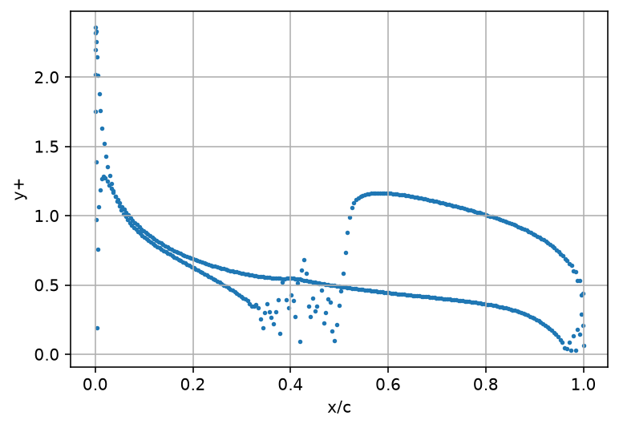

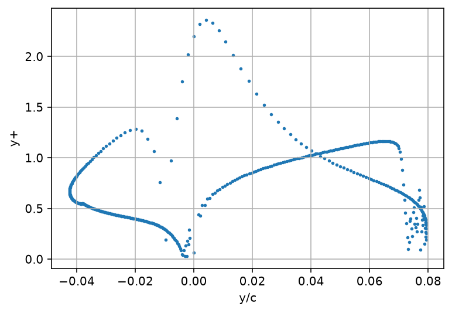

Figure. Dimensionless wall distance along the NACA 2412 airfoil surface at an angle of attack of 4°.

The maximum recorded $y^+$ was approximately 2.4, while most values remained below approximately 1.3.

Local variations were observed, particularly around $x/c = 0.35$–$0.50$, where the skin-friction distribution also exhibited oscillations.

Overall, the near-wall resolution was reasonably close to the initial target, although the actual $y^+$ varied along the airfoil surface.

However, satisfying the target $y^+$ does not guarantee mesh independence or the accuracy of the predicted boundary-layer transition. Further mesh sensitivity analysis is required.

### 4.3 Computational Domain Sensitivity (Planned)

Not yet tested.

### 4.4 Mesh Independence Study(Planed)

Not yet tested.

## 5. Results and Discussion

### 5.1 Aerodynamic Coefficient Comparison

The aerodynamic coefficients predicted by ANSYS Fluent were compared with XFOIL results at an angle of attack of $4^\circ$ and a Reynolds number of approximately $10^6$.

The comparison includes the lift coefficient ($C_L$), drag coefficient ($C_D$), and pitching moment coefficient ($C_M$).

The relative difference was calculated using:

$$
\epsilon_C = \frac{|C_{\mathrm{Fluent}}-C_{\mathrm{XFOIL}}|}{|C_{\mathrm{XFOIL}}|}\times100%
$$

#### Python Analysis Output

```text
cl different percentage：4.98309%
cd different percentage：18.41817%
cm different percentage：6.49617%
```
The lift coefficient shows relatively close agreement between Fluent and XFOIL.

However. there is a large different between their drag coefficient. And as discussed in 4.1, drag coefficient did not satisfy the selected convergence criterion. 

These results provide an initial assessment of agreement between the two numerical methods, rather than a complete validation against experimental measurements.

### 5.2 Pressure Coefficient Distribution

The pressure coefficient distributions predicted by ANSYS Fluent and XFOIL were compared to investigate the agreement in surface pressure predictions.

The comparison at an angle of attack of $4^\circ$ is shown below:

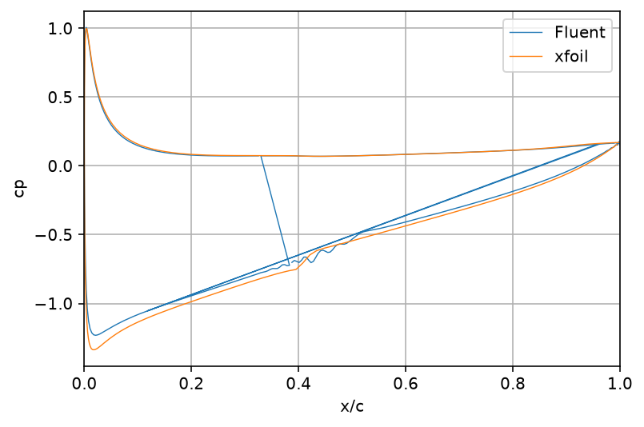

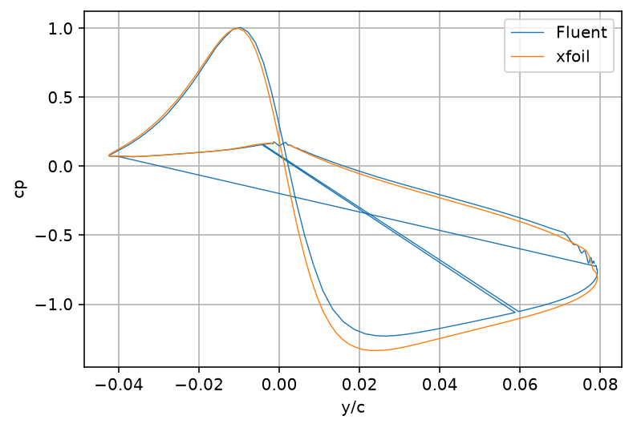

Figure. Comparison of pressure coefficient distributions between ANSYS Fluent and XFOIL for the NACA 2412 airfoil at 4° angle of attack.

The Fluent and XFOIL predictions show broadly similar pressure distributions over the airfoil.
A negative pressure coefficient is observed on much of the upper surface, indicating a region of lower static pressure relative to the freestream. The pressure difference between the upper and lower surfaces contributes to the lift generated by the airfoil.

Differences between the two predictions are observed near the leading edge and over parts of the upper surface.

These differences may be associated with variations in boundary-layer development, transition prediction, or numerical modelling.
Overall, the pressure coefficient comparison indicates reasonable agreement in the general pressure distribution. However, further investigation is required to determine the causes of the local discrepancies.

### 5.3 Skin-Friction Coefficient and Transition Analysis

The skin-friction coefficient distributions obtained from ANSYS Fluent and XFOIL were compared to investigate boundary-layer behaviour and possible laminar-to-turbulent transition.

The comparison at an angle of attack of $4^\circ$ is shown below:

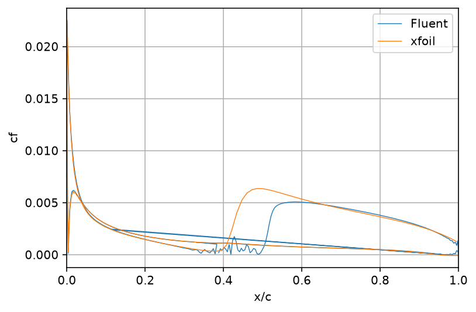

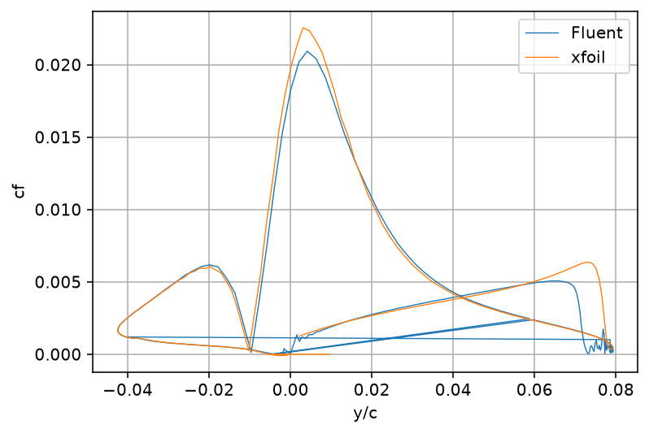

Figure. Comparison of skin-friction coefficient distributions between Fluent and XFOIL.

The Fluent and XFOIL predictions show broadly similar trends over several regions of the airfoil surface.

However, noticeable differences are observed on the upper surface around $x/c \approx 0.35$–$0.50$.

In this region, the Fluent skin-friction coefficient exhibits oscillations and multiple zero-crossings, followed by a relatively sharp increase downstream.

### 5.4 Wall Shear Stress Analysis

The wall shear stress distribution was examined to investigate possible flow separation and reattachment along the airfoil surface.

For a two-dimensional flow, a change in the sign of the local tangential wall shear stress may indicate a reversal of the near-wall flow direction.

Potential separation and reattachment locations can therefore be investigated by identifying zero-crossings in the signed wall shear stress distribution.

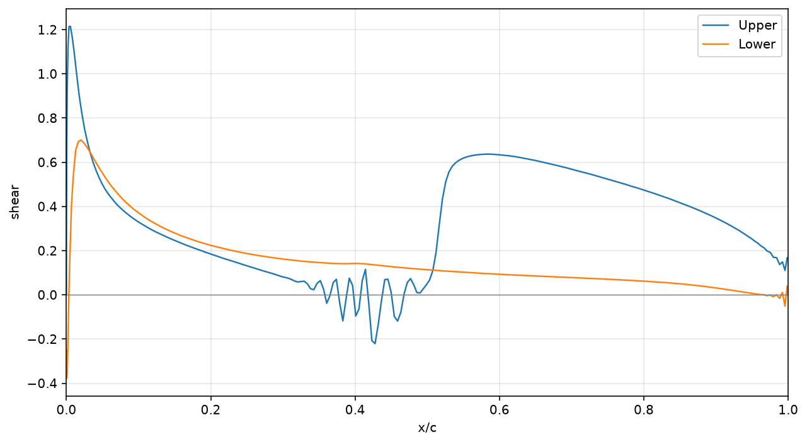

Figure. Wall shear stress distribution along the NACA 2412 airfoil surface at an angle of attack of 4°.

Multiple zero-crossings were detected around $x/c \approx 0.35$–$0.50$, corresponding to the region where oscillations were also observed in the skin-friction coefficient.

The repeated sign changes may indicate possible near-wall flow reversal. However, they may also be caused by numerical oscillations, insufficient spatial resolution, or post-processing artefacts.

#### Local Flow-Field Observation

A magnified velocity contour near the airfoil surface was also examined to provide additional evidence for the behaviour observed in the skin-friction and wall-shear-stress distributions.

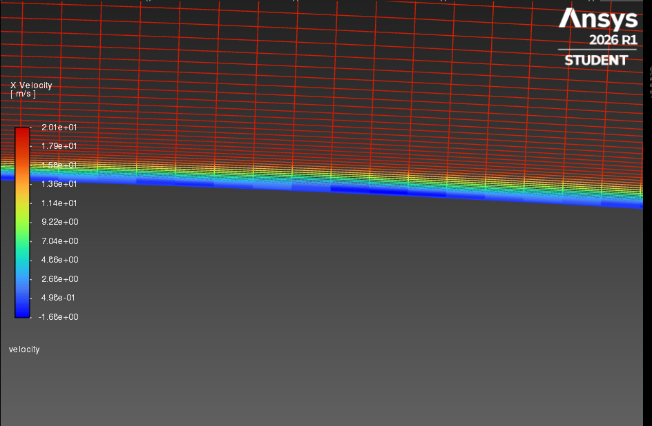

*Figure. Magnified x-velocity contour near the airfoil surface.*

A small region of possible local reverse flow was observed in the near-wall region, where the streamwise velocity appeared to become locally negative.

This behaviour may be associated with boundary-layer separation and possible recirculation.

Such a feature could be consistent with the presence of a laminar separation bubble.

However, this interpretation remains preliminary.

## 5.5 Discussion and Limitations

The preliminary comparison between ANSYS Fluent and XFOIL shows reasonable agreement in lift coefficient and surface pressure distributions at an angle of attack of $4^\circ$.

However, several discrepancies and uncertainties remain.

1. Aerodynamic Coefficient Differences

The lift coefficient differs from the XFOIL prediction by approximately 5%, while the drag coefficient shows a larger difference of approximately 18%.

The drag coefficient also failed to satisfy the selected convergence criterion, indicating that further convergence investigation is required.

2. Boundary-Layer Behaviour

Oscillations and multiple zero-crossings were observed in the skin-friction and wall-shear-stress distributions around $x/c \approx 0.35$–$0.50$.

A magnified velocity contour also suggested possible local reverse flow near the airfoil surface.

These observations may be associated with boundary-layer separation, transition, and reattachment. However, the presence of a laminar separation bubble has not yet been confirmed.

3. Numerical Limitations

The computational domain sensitivity and mesh independence studies have not yet been completed.

Therefore, the influence of far-field boundary placement and spatial discretisation on the aerodynamic predictions remains uncertain.

4. Validation Limitations

XFOIL provides a useful numerical reference, but agreement between Fluent and XFOIL does not independently establish physical accuracy.

Comparison with experimental measurements will be required for a more comprehensive validation.

Summary

The current results provide a preliminary assessment of the Fluent simulation at a low angle of attack.

Further numerical verification and investigation of boundary-layer behaviour are required before extending the study to higher angles of attack and stall prediction.
